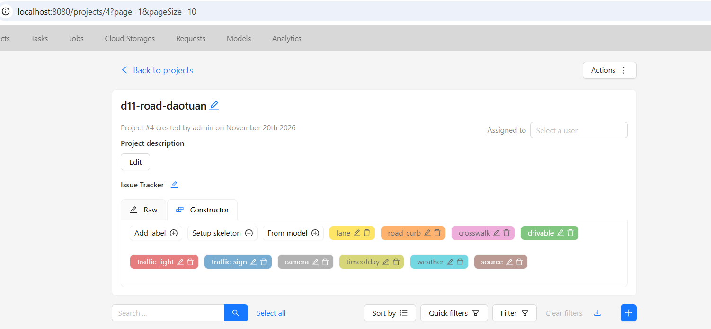
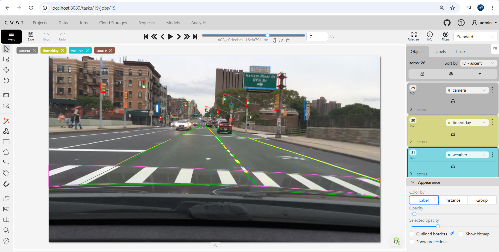
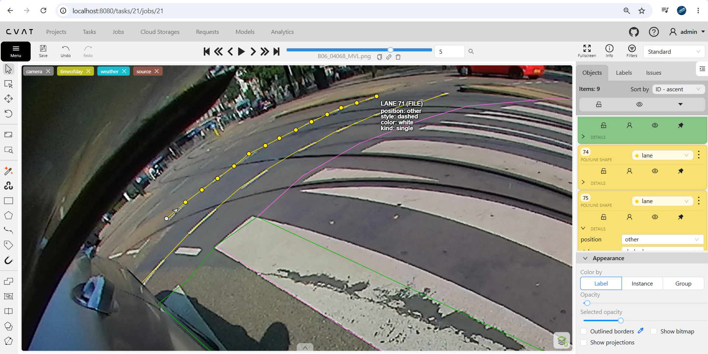
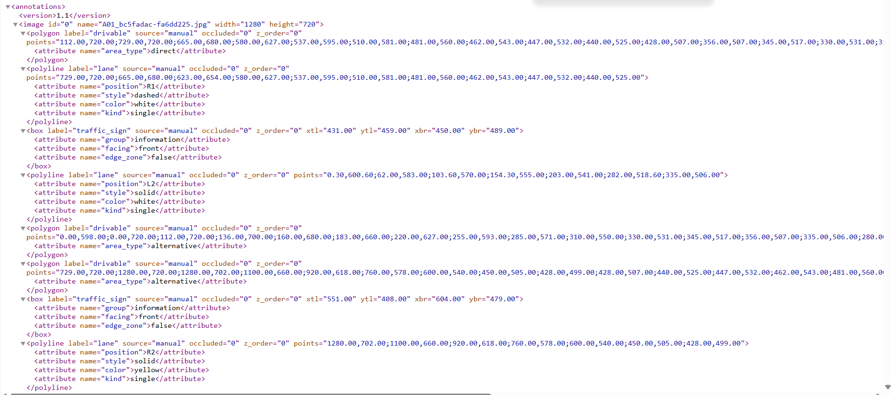

# Báo cáo cá nhân — Ngày 11
Họ tên: Đào Quang Tuấn               Mã học viên: 2A202603194  
Phiên bản CVAT (Help → About): 2.82.1  
Guideline: Road v1.0    Lần nộp (`revision` trong manifest): 2  
Thời điểm export (ngày giờ trên CVAT): 21/11/2026, 10:04 (revision 1: 20/11/2026, 19:32)    Số lần nộp lại sau Rework: 1  

## 1. Kiểm project
| Mục | Đúng như guideline Road v1.0? | Ghi chú |
| --- | --- | --- |
| 6 label, đúng kiểu | Đúng | lane, road_curb: polyline · crosswalk, drivable: polygon · traffic_light, traffic_sign: rectangle |
| Thuộc tính và giá trị | Đúng | Đã so với Raw labels JSON (`configs/road_v1_labels.json`) |
| 4 tag ảnh | Đúng | camera, timeofday, weather, source; mỗi tag có thuộc tính select `value` |
Cách kết thúc polyline trên bản CVAT này: nhấn phím N (hoặc double-click vào điểm cuối).  
Cách đặt tag ảnh trên bản CVAT này: nút Setup tag ở thanh công cụ trái → chọn label → Add tag; chọn giá trị `value` trong panel Objects bên phải. CVAT tự điền giá trị đầu danh sách nên phải kiểm lại từng ảnh.  

## 2. Số lượng đã gán
| Task | Ảnh | lane | road_curb | crosswalk | drivable | traffic_light | traffic_sign |
| --- | ---: | ---: | ---: | ---: | ---: | ---: | ---: |
| front | 12 | 36 | 11 | 4 | 23 | 37 | 36 |
| front-extra (đã làm 4 / 4) | 4 | 14 | 1 | 2 | 8 | 8 | 15 |
| fisheye | 8 | 10 | 14 | 8 | 10 | 8 | 10 |
| fisheye-extra (đã làm 4 / 4) | 4 | 1 | 3 | 4 | 4 | 1 | 1 |

## 3. Bảng ca khó
| Ảnh | Nhãn | Phân vân giữa | Đã chọn | Lý do |
| --- | --- | --- | --- | --- |
| A03 | tag timeofday, weather | day / dusk; clear / overcast | dusk, clear | Trời hồng tím, ánh sáng đã yếu nên chọn dusk; mặt đường khô, mây không phủ kín bầu trời nên chọn clear. |
| A16 | tag timeofday, weather | day / dusk | dusk, overcast | Toà nhà và đèn hậu xe đã bật sáng; trời xám đều nhưng mặt đường khô nên chọn overcast, không phải rain. |
| A04, A06, A09, A11, A14 | lane (vạch đôi) | 1 polyline giữa cặp vạch hay 2 polyline | 2 polyline, kind = double | Theo hướng dẫn của giảng viên: mỗi polyline đặt trên tâm một vệt sơn, cùng position, vẽ từ gần xe ra xa. Lint báo QC1-05 "2 polyline cùng position" — chấp nhận cảnh báo này. |
| A05 | lane L1, R1 | vẽ ước lượng hay bỏ trống | không vẽ | Mặt đường không có vạch sơn. Guideline chỉ gán vạch nhìn thấy; vẽ thêm sẽ là lane thừa (QC1-03, nặng). Coach đã xác nhận miễn QC1-02. |
| A09 | lane R1 | vẽ ước lượng hay bỏ trống | không vẽ | Phía phải xe không thấy vạch sơn rõ (chỉ có bóng và vệt mờ). Coach đã xác nhận miễn QC1-02. |

## 4. Phiếu QC 1 nhận được
Bạn kiểm lô của tôi: ____  Quyết định nhận được: ____  
| Mã lỗi | Số lỗi | Đồng ý? | Đã sửa? |
| --- | ---: | --- | --- |
|  |  |  |  |

Đã sửa ở revision 2 (bản revision 1 cất trong `r1/`):
- Bổ sung `road_curb` ở mép đường không sơn: A03, A04 (2), A08 (3), A11, A16, B02 (2), B03, B06, B07 (2), B08 (2), B10, B12 — front 4 → 12, fisheye 7 → 17 road_curb.
- Chỉnh lại điểm cho sát hơn: B03 (drivable, road_curb), B04 (road_curb, crosswalk), B05 (crosswalk, road_curb), B07 (lane other), B12 (crosswalk).
- Không đổi tag; lint sau khi sửa không có cảnh báo mới (9 cảnh báo đã biết: vạch đôi 2 polyline, A05/A09 không có vạch).

## 5. Kiểm file export
| File | Mở lại được? | Số shape ảnh 1 (job / file) | Số shape ảnh 2 (job / file) | Tag camera có trong XML? |
| --- | --- | --- | --- | --- |
| daotuan-front.zip | Có (lint đọc được 16 ảnh) | A01: 9 / 9 | A02: 5 / 5 | Có (`front`) |
| daotuan-fisheye.zip | Có (lint đọc được 12 ảnh) | B01: 4 / 4 | B02: 9 / 9 | Có (`fisheye_front`) |

## 6. Ảnh chụp màn hình
1. Tab Labels của project.  
   
2. Một ảnh camera trước đã gán đủ (làn, vùng lái, đèn/biển).  
   
3. Một ảnh fisheye đã gán, phóng to đoạn polyline cong.  
   
4. Một đoạn XML có <polyline label="lane">.  
   

## 7. Tự đánh giá
Lỗi bạn mắc nhiều nhất hôm nay (theo mã QC1-xx), và cách tránh ở Ngày 20:  
QC1-03 (position): ở A01 ban đầu gán vạch bên phải xe thành L1, sau đó lại đổi lẫn L1 với R1. Tiếp theo là QC1-04 (chiều vẽ): R2 ở A01 và L1 ở A07 bị vẽ từ xa về gần. Cách tránh: trước khi vẽ, xác định tâm mũi xe (giữa ảnh, sát đáy) — vạch gần nhất bên trái là L1, bên phải là R1; luôn đặt điểm đầu tiên ở đáy ảnh, sát xe; chạy lint sau mỗi vài ảnh thay vì đợi cuối giờ.

Nhãn của bạn đi vào model ở đâu? Chọn một lỗi đã sửa và nói nó làm model học sai thế nào:  
Polyline lane được đổi thành đích cho model phát hiện làn (ví dụ row-anchor: mỗi hàng ảnh một giá trị x cho từng vị trí L1/R1/L2/R2). Nếu L1 và R1 bị đổi chỗ, model học rằng mép trái của làn đang đi nằm bên phải; hệ thống giữ làn (LKA) dựa trên L1/R1 sẽ tính sai tâm làn và lái lệch về phía vạch sai. Nếu vẽ ngược chiều (xa → gần), điểm đầu — điểm quan trọng nhất, sát xe — bị đặt ở đường chân trời, nên các script lấy mẫu theo thứ tự điểm sẽ sinh đích sai ở những hàng gần xe, đúng vùng mà LKA cần chính xác nhất.

## 8. (Tùy chọn, buffer) Từ polyline đến đích row-anchor
| y | 720 | 680 | 640 | 600 | 560 |
| --- | ---: | ---: | ---: | ---: | ---: |
| x của chúng tôi |  |  |  |  |  |
| x của bạn kia |  |  |  |  |  |
